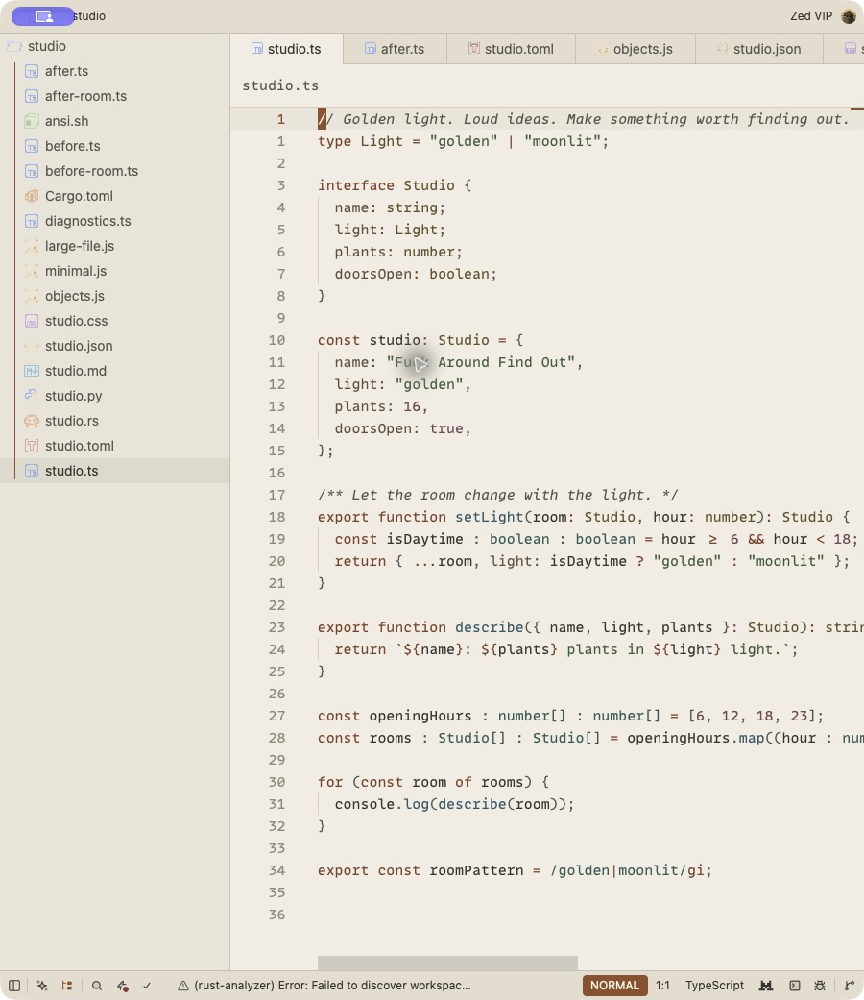
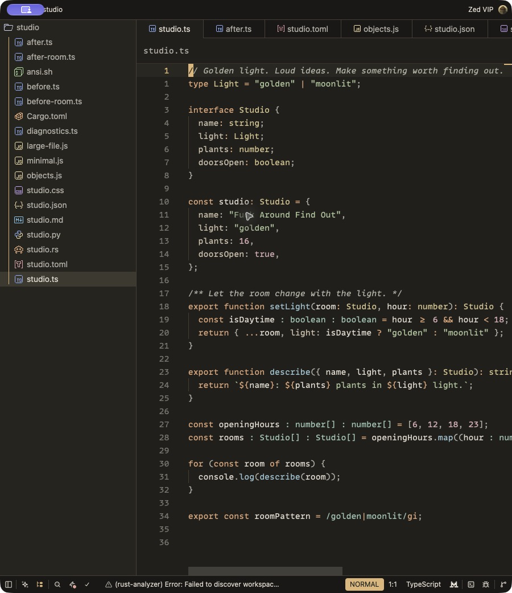
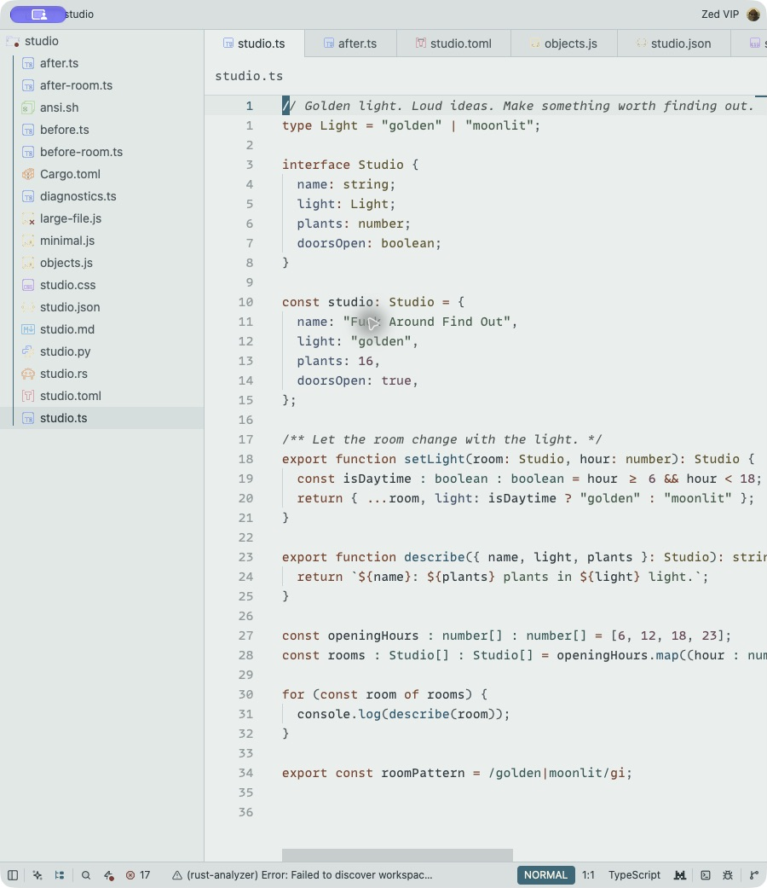
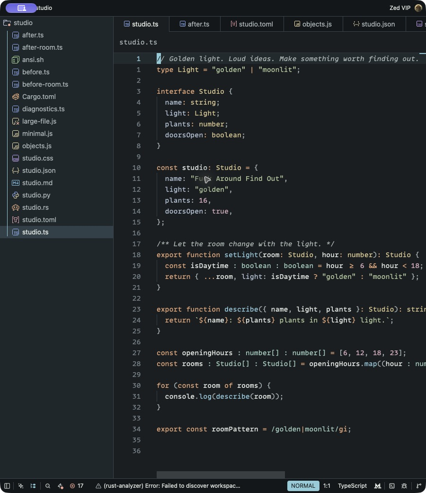

# Fuck Around Find Out

Golden-hour warmth. After-hours clarity.

Two studio-inspired palettes for Zed, each in light and dark mode, with solid
and native blurred finishes. Quiet surfaces, readable comments, and enough
color to find your way through a long file.

| Daytime Light | Daytime Dark |
| --- | --- |
|  |  |
| Warm plaster, copper, slate blue, and sage. | Warm charcoal, amber, dusty rose, and soft blue. |

| Nighttime Light | Nighttime Dark |
| --- | --- |
|  |  |
| Cool stone with teal, ink blue, and copper. | Graphite with cyan, apricot, sage, and muted gold. |

## Eight ways to find out

Every theme name starts with **Fuck Around Find Out -**.

| Palette | Solid | Glass |
| --- | --- | --- |
| Daytime, light mode | Daytime Light | Daytime Light Blur |
| Daytime, dark mode | Daytime Dark | Daytime Dark Blur |
| Nighttime, light mode | Nighttime Light | Nighttime Light Blur |
| Nighttime, dark mode | Nighttime Dark | Nighttime Dark Blur |

The Blur editions use Zed's native background blur with a translucent tint.
The material covers the workspace, sidebar, and terminal; menus and selections
retain enough structure to stay readable. The effect depends on the desktop
behind Zed and your platform's blur support. It is inspired by thin macOS
materials; Zed does not expose SwiftUI's material presets or blur radius.

[Compare all eight variants and language samples](docs/gallery.md).

## Install

1. Clone or download this repository.
2. In Zed, open **Extensions**, choose **Install Dev Extension**, and select the
   folder containing `extension.toml`.
3. Open the theme selector with **Cmd-K, Cmd-T** on macOS or **Ctrl-K, Ctrl-T**
   on Linux/Windows. Search for **Fuck Around Find Out**.

After pulling updates, run **zed: rebuild dev extension** and choose
**Fuck Around Find Out**.

To follow your system appearance, add this to your Zed settings:

```json
{
  "theme": {
    "mode": "system",
    "light": "Fuck Around Find Out - Daytime Light",
    "dark": "Fuck Around Find Out - Nighttime Dark"
  }
}
```

Use either palette for either mode, and append ` Blur` to either name for the
glass finish. Fonts, font sizes, icon themes, and editor behavior stay yours.

Alternatively, copy `themes/fafo.json` into Zed's local themes directory.
See [Zed's theme documentation](https://zed.dev/docs/themes) for platform paths.

## Built for actual work

- All **190 current theme style fields** are explicitly set in every variant.
- **55 syntax captures**, including keys, regexes, Markdown, and diff syntax.
- Diagnostics, Git diff and conflict colors, debugger highlights, search,
  selections, panels, scrollbars, minimap, and Vim/Helix mode badges.
- Normal, bright, and dim terminal palettes, plus eight collaboration colors.
- Native review with TypeScript, JavaScript, TOML, Rust, Python, JSON, CSS, and
  Markdown, from three-line snippets to a **58,001-line** JavaScript file.

The [validation record](docs/validation.md) distinguishes the native checks
from the schema and contrast checks, and lists the remaining platform limits.

Try the specimens in `examples/`. Run `sh examples/ansi.sh` in Zed's terminal
to inspect the terminal palette.

Zed's JavaScript/TypeScript grammar treats quoted object keys as strings.
Those keys share the string color; bare object keys, JSON keys, and TOML keys
use the property color.
